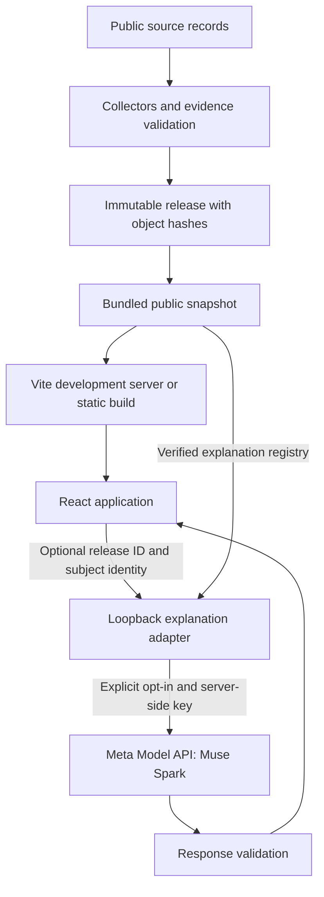

# Architecture

WattDocket separates public evidence, deterministic calculations and model explanations. Missing evidence stays missing. A regional grid factor, hypothetical reference load or permit limit does not become a facility measurement.

This repository contains application source, collectors, validation code and a verified public data snapshot. AWS account configuration, deployment automation and live operational archives are outside its scope. See [hosting guidance](docs/DEPLOYMENT.md).

## Runtime



The default local app serves data from the clone. It does not proxy data to the live site or call the production explanation service. The browser reads the current pointer once and pins a release for the session. A failed read cannot silently mix in records from another release.

## Components

| Component | Location | Responsibility |
| --- | --- | --- |
| Deterministic engine | `core/wattdocket/` | Units, dates, estimates, citations and evidence rules |
| Collectors and release builder | `core/wattdocket/production/` | Source adapters, facility identity, disclosure boundaries, permit reviews and immutable payloads |
| Public snapshot | `site/data/current.json`, `site/data/releases/` | A pinned manifest and compressed public objects, including cards, evidence, grid data and explanation facts |
| Snapshot synchronization | `scripts/sync_public_data.py` | Fetch one published release, verify every object and replace the local pointer only after all checks pass |
| Local snapshot delivery | `web/scripts/local-snapshot.ts` | Verify bundled objects before serving them; emit portable JSON assets into the static build |
| Web application | `web/src/` | Reported data, learning pages, public records, permits, grid context and the operator workspace |
| Interactive calculator | `web/src/scenario.ts` | Deterministic calculations from explicitly hypothetical inputs and a cited historical grid factor |
| Explanation registry | `core/wattdocket/production/explain_registry.py` | Build server-owned facts, citations, qualifiers and deterministic fallbacks for canonical subjects |
| Explanation handler | `api/lambda_explain/` | Construct bounded prompts and validate model replies; production storage and quota interfaces are isolated here |
| Local explanation adapter | `scripts/serve_local_explain.py` | Reuse the handler with a local registry and an in-memory attempt limit, without AWS |
| Permit reader | `scripts/read_permit_with_muse.py`, `core/wattdocket/permits.py` | Ask for document references, then verify each quoted passage against the source text |

`data/`, test fixtures and `site/api/` also contain archived source inputs and legacy static payloads. They support tests and compatibility tools; the default UI reads the release named by `site/data/current.json`.

## Data identity and freshness

A release manifest identifies the build time, revision, object paths, byte lengths and SHA-256 hashes. Its object set includes the facility index, card and drawer bundles, operator scenarios, annual disclosures, historical power observations, permit evidence, grid series and explanation registry. Inspect the manifest for the exact coverage of the checked-out snapshot; counts are not hardcoded in this document.

Files under `site/data/releases/` are gzip-compressed copies of public JSON. Hashes cover their uncompressed bytes. Development and build startup verify those bytes against the manifest. `npm run build` writes the selected snapshot as ordinary JSON under `web/dist/data/`, alongside the app and bundled demo media, so a static server does not need custom gzip routing.

The snapshot does not refresh itself when someone opens the website. A maintainer explicitly runs the synchronization script, reviews the changes and commits them. Refreshing retains older local releases and changes the pointer only after verification. Restart a development server to select the new snapshot. Live collector health is not fabricated for the local copy. Source retrieval dates and reporting periods remain those of the captured evidence.

See [the snapshot guide](docs/DATA-SNAPSHOT.md) and [data provenance](DATA-PROVENANCE.md).

## Model boundary

The browser sends only the displayed `release_id` and canonical subject `{kind, id}`. Subjects can be a facility, disclosure location, power site or permit document. Client-supplied prompts, numerical facts and chart filters are not inputs to the model.

The server selects the subject from that release's verified registry. A reply must pass checks for bound numerals, fact identifiers, citations and required scope qualifiers. A refusal, timeout or rejected reply produces a labeled deterministic fallback. These checks constrain output; they do not make every sentence an independently verified conclusion.

The loopback adapter loads the same handler and response validator as the application source. It substitutes filesystem registry loading and an atomic in-memory attempt limit for production storage and quota services. It binds to `127.0.0.1`, accepts explicitly allowed loopback origins, and disables model calls by default. Paid calls require `--enable-model`, the developer's own `META_API_KEY` and `MODEL_OFF=0`. The default limit is ten attempts per UTC day per process; restarting resets it. This is a development service, not a public hosting configuration.

The separate permit-reader utility also requires an explicit model call. Its verified page, line and quote results remain subject to document identity and scope checks. No model is used to fill an unknown facility measurement.

## Local development and verification

The web app requires Node.js 22.12+ or 24+. Python is optional for the basic web experience.

```sh
cd web
npm ci
npm run dev
```

See [web development](web/README.md) for build, tests and optional local explanation setup. CI verifies the bundled snapshot, runs Python engine and API tests with model calls disabled, and checks the frontend on Node 22 and 24. No deployment credentials are needed.
